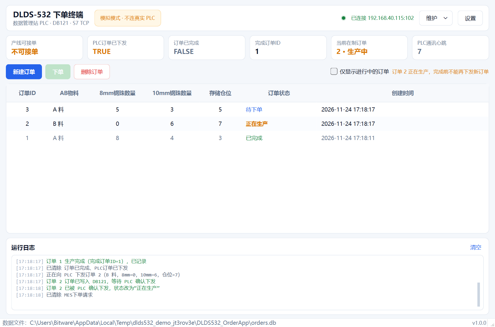
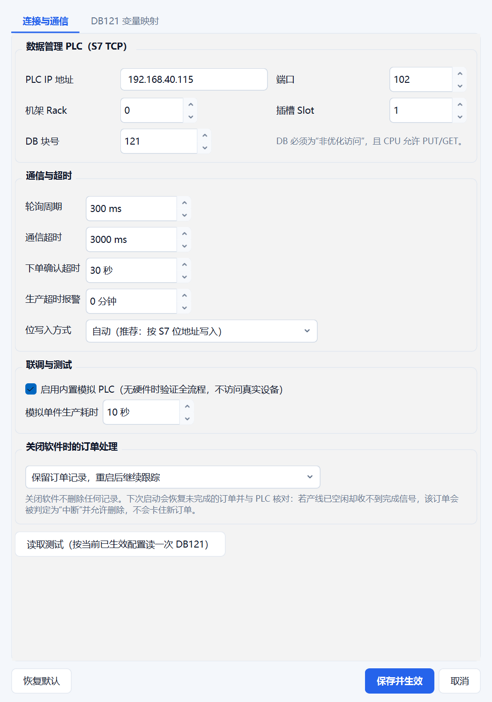

# DLDS-532 下单软件（Windows 桌面版）

**版本 v1.1.0** ｜ Python 3.12 + PySide6 6.12 + python-snap7 3.6 ｜ S7 TCP

用于 DLDS-532 实训平台的**下单终端**：在 Windows 上新建订单，通过 S7 TCP 把订单写入数据管理站 PLC 的 **DB121**，按 PLC 的握手信号推进订单状态并保存到本地 SQLite。

- 不是网页，不需要浏览器；单文件 EXE，双击即用
- 只做「新建订单 / 下单 / 查看订单状态」三件事
- 不控制气缸、电机等设备，设备动作仍由 PLC 原程序负责
- PLC 通讯心跳由 PLC 维护，软件**只读不写**
- 同一时间只允许一笔订单进入 PLC；完成信号必须订单ID匹配才认可，旧信号不会误判新订单
- 重启后自动与 PLC 对账：产线已空闲却没收到完成信号的订单会被判「中断」，不会永久卡住流程
- 关闭软件时可选「保留 / 清除未完成 / 清空全部」三种订单处理策略



---

## 1. 运行方式

### 直接运行（推荐给现场）
双击 `dist\DLDS532_OrderApp.exe`。首次启动会自动生成配置文件与数据库。

### 从源码运行（开发）
```bat
python -m venv .venv
.venv\Scripts\pip install -r requirements.txt
.venv\Scripts\python main.py
```
或双击 `run_dev.bat`。

### 重新打包 EXE
```bat
build_exe.bat
```
等价于 `python tools\make_assets.py` + `python -m PyInstaller DLDS532_OrderApp.spec --noconfirm`，产物在 `dist\DLDS532_OrderApp.exe`（单文件，约 44 MB）。

> 仓库只提交源码、资源与构建配置；`.venv/`、`dist/`、`build/`、运行时数据库与日志都已写入 `.gitignore`，重新打包即可得到 EXE。

---

## 2. 界面说明

| 区域 | 内容 |
|---|---|
| 顶部 | 软件名、连接状态灯、`IP:端口`、维护菜单、设置 |
| 状态卡 | 产线可接单、PLC订单已下发、订单已完成、完成订单ID、当前在制订单、PLC通讯心跳（均直接来自 DB121 实时值） |
| 订单列表 | 订单ID、AB物料、8mm钢珠数量、10mm钢珠数量、存储仓位、订单状态、创建时间 |
| 按钮 | 新建订单、下单、删除订单（在流程中的订单删除时会先强制终止） |
| 底部 | 运行日志（每次通信、状态变化、失败原因都留痕，同时写入数据库 events 表） |

「下单」按钮只有在下列条件全部满足时才可点击，否则鼠标悬停会显示具体原因：

1. PLC 在线
2. `产线可接单 = TRUE`
3. 当前没有在制/待确认订单（同一时间只允许一笔）
4. 上一笔订单的握手信号已清除完毕
5. 选中的订单状态为「待下单」或「下单失败」（失败可重试）

### 订单卡住时怎么办（「不能删除」的处理）

订单停在「正在生产 / 等待PLC确认」时不能直接删除，这是有意设计的（防止把正在生产的单删掉）。三种解除方式：

1. **重启后自动对账**：重新打开软件时，如果 PLC 已经空闲（`产线可接单=TRUE`）却收不到这笔订单的完成信号，
   软件会在约 5 秒内把它判定为「下单失败（中断）」并解除占位，之后就能删除或重新下单。
2. **强制删除**：选中该订单点「删除订单」，确认后会先把它标记为「下单失败（人工终止）」再删除本地记录。
3. **维护 → 终止当前在制订单**：只解除软件里的占位并撤销 `MES下单请求`，不停止 PLC 的设备动作。

> 三种方式都只改本地状态，不会让 PLC 停下来，也不会把订单标成「已完成」。现场请先核实产线实物。

---

## 3. 下单与握手时序

| 步骤 | 软件动作 | 写入 / 读取 DB121 |
|---|---|---|
| 1 | 新建订单，生成唯一订单ID（INT，1–32767），存本地 | — |
| 2 | 点击下单，做 5 项预检 | 读 全部变量 |
| 3 | 写入订单参数 | 写 订单ID、AB物料、8mm、10mm、存储仓位 |
| 4 | **回读校验**参数是否一致，不一致直接判失败（不置请求位） | 读 全部变量 |
| 5 | 置下单请求 | 写 `MES下单请求=TRUE`，回读确认 |
| 6 | 等待 PLC 接单 | 读 `PLC订单已下发`，并核对 `订单ID` 一致 |
| 7 | 确认后状态改为「正在生产」，**先落库再清位** | 写 `MES下单请求=FALSE` |
| 8 | 等待完成 | 读 `订单已完成` + `完成订单ID` |
| 9 | `完成订单ID` == 当前订单ID → 状态改为「已完成」，先落库 | 写 `订单已完成=FALSE`、`PLC订单已下发=FALSE` |
| 10 | 两个信号回读确认清除后，才允许下一单 | 读 全部变量 |

### 状态流转
```
待下单 ──下单──▶ 待下单·等待PLC确认 ──PLC订单已下发──▶ 正在生产 ──订单已完成且ID一致──▶ 已完成
                      │
                      └──确认超时 / 写入失败 / 参数校验失败──▶ 下单失败（可重试）
```

---

## 4. 防误判规则（与需求逐条对应）

| 需求 | 实现方式 |
|---|---|
| 不允许旧完成信号误判新订单 | 必须 `订单已完成=TRUE` **且** `完成订单ID == 当前订单ID` 才改状态；ID 不一致只记警告，不改任何订单 |
| 空闲时收到遗留完成信号 | 记日志「遗留完成信号（完成订单ID=x）」并自动清除，不影响新订单；不会把任何订单标成已完成 |
| 不允许覆盖在制订单参数 | `current` 非空时禁止下发；发送前还会再读一次 PLC，确认参数区空闲 |
| 同一时间只有一笔订单 | 数据库只有一笔处于「等待确认/正在生产」的订单，其余仅本地排队 |
| 未确认下发不得重复发送 | 已发送未确认的订单会锁住「下单」按钮，直到确认或超时 |
| 写入失败/断线/超时必须明确提示 | 订单转「下单失败」并写入失败原因，同时弹窗 + 日志 + 数据库留痕，绝不标记成功 |
| 清 PLC 状态前必须先保存 | 完成时先把 `status/completed_at/plc_done_id` 提交数据库，再发清位指令 |
| 清位失败 | 每 2 秒自动重试（最多 10 次），期间禁止下一单并持续报警 |
| 心跳只读 | 仅显示与「心跳停滞」告警，从不写入 |
| 软件重启恢复 | 启动时从 SQLite 恢复在制订单，再读 PLC 校对；重启期间 PLC 已完成则按 ID 匹配正常收单，不会误判 |
| 重启后订单不卡死 | 对账宽限 5 秒：PLC 已空闲却无完成信号、或 `PLC订单已下发=FALSE` 且订单ID 不匹配，判定为「中断」并解除占位（不会标成功） |
| 关闭软件时的数据 | 三种策略可选：保留并继续跟踪 / 清除未完成（标记中断）/ 清空全部记录，见第 6 节 |

---

## 5. DB121 默认变量映射

DB121「MES订单数据」，非优化访问（`S7_Optimized_Access := 'FALSE'`）。

| 变量 | 类型 | 默认偏移 | 方向 |
|---|---|---|---|
| 订单ID | INT | 0 | MES 写 |
| AB物料 | INT | 2 | MES 写 |
| 8mm钢珠数量 | INT | 4 | MES 写 |
| 10mm钢珠数量 | INT | 6 | MES 写 |
| 存储仓位 | INT | 8 | MES 写 |
| PLC通讯心跳 | INT | 10 | PLC 写，MES 只读 |
| MES下单请求 | BOOL | 12.0 | MES 写 |
| PLC订单已下发 | BOOL | 12.1 | PLC 写，MES 清 |
| 产线可接单 | BOOL | 12.2 | PLC 写，MES 只读 |
| 订单已完成 | BOOL | 12.3 | PLC 写，MES 清 |
| 完成订单ID | INT | 14 | PLC 写，MES 只读 |

**全部偏移与类型都可以在「设置 → DB121 变量映射」里修改**，保存时自动校验：地址能否解析、位号 0–7、类型与位号是否冲突、地址是否重叠、是否越界、总跨度是否合理。

> 位变量按 **S7 位地址**（`字节×8+位号`）单独写入，不会破坏同一字节里由 PLC 维护的其他位。若现场固件不支持按位写，可在设置里切换为「兼容（读-改-写整字节）」。

---

## 6. 设置页

| 项 | 默认 | 说明 |
|---|---|---|
| PLC IP | 192.168.40.115 | 数据管理站 PLC |
| 端口 | 102 | S7 TCP 标准端口 |
| 机架 / 插槽 | 0 / 1 | S7-1200/1500 常用 0/1 |
| DB 块号 | 121 | |
| 轮询周期 | 300 ms | 50–10000 |
| 通信超时 | 3000 ms | 200–30000 |
| 下单确认超时 | 30 s | 超过即判「下单失败」并撤销请求 |
| 生产超时报警 | 0（关闭） | 仅报警，不改订单状态 |
| 位写入方式 | 自动 | 按位写失败会自动退化为读改写并记录 |
| 模拟 PLC | 关闭 | 无硬件时验证全流程，**不访问真实设备** |
| 关闭软件时的订单处理 | 保留并继续跟踪 | 三选一，见下 |

「读取测试」按钮会按当前生效配置读一次 DB121，逐项显示数值和地址，用于和 TIA 监控表逐条对照。

### 关闭软件时的订单处理（v1.1 新增）

设置页 → 连接与通信 → 「关闭软件时的订单处理」：



| 选项 | 关闭软件时 | 下次启动 |
|---|---|---|
| **保留订单记录，重启后继续跟踪**（默认） | 不删任何数据 | 恢复未完成订单并与 PLC 对账：仍在线生产就继续跟踪；产线已空闲则判定「中断」（约 5 秒），解除占位且可删除 |
| **关闭时清除未完成订单（保留已完成历史）** | 把仍在流程中的订单标记为「下单失败（中断）」 | 不再恢复这些订单，直接可下新单；已完成/失败历史保留 |
| **关闭时清空全部订单记录** | 删除全部订单（运行日志保留） | 订单列表为空；PLC 里若有遗留的完成信号，会记录为「遗留完成信号」并自动清除 |

选「保留」时若还有在制订单，关闭前会提示一次，避免误关导致完成记录丢失。
三种策略都不会修改 PLC 的订单参数，也不会把任何订单标成「已完成」。

---

## 7. 现场联调步骤

1. **备份**：TIA 里导出 DB121 或整机备份；确认 DB121 属性为「非优化访问」，CPU 勾选「允许来自远程伙伴的 PUT/GET」。
2. **核对地址**：TIA 在线监控 DB121，逐项对照第 5 节偏移；不一致就在设置页改。
3. **连通**：软件设置页填 IP/机架/插槽/DB 号 → 保存 → 点「读取测试」，数值应与 TIA 一致。
4. **可接单**：手动在 TIA 里把 `产线可接单` 置 TRUE。
5. **下单**：软件新建订单 → 选中 → 下单。观察 DB121：5 个参数被写入，`MES下单请求` 变 TRUE。
6. **确认**：PLC 程序把 `PLC订单已下发` 置 TRUE（`订单ID` 保持软件写入值）。软件应转「正在生产」，并自动把 `MES下单请求` 清回 FALSE。
7. **完成**：PLC 置 `订单已完成=TRUE`、`完成订单ID=订单ID`。软件应转「已完成」，并自动把 `订单已完成`、`PLC订单已下发` 清回 FALSE。
8. **连续验证**：连做 3 单，确认无串单、订单ID/参数/仓位逐单正确。
9. **异常验证**：
   - 拔网线 10 秒：界面变「未连接」，订单状态保持不变；插回后自动重连并继续跟踪。
   - 把「下单确认超时」改成 5 秒，让 PLC 不确认：订单应变「下单失败」，`MES下单请求` 被撤销。
   - 让 PLC 只置 `订单已完成` 而不改 `完成订单ID`：软件应忽略并告警，不会误判。

联调完成后再把「下单确认超时」调回 30 秒。

---

## 8. 数据文件

默认目录：`%LOCALAPPDATA%\DLDS532_OrderApp\`

| 文件 | 说明 |
|---|---|
| `config.json` | 连接参数与变量映射 |
| `orders.db` | SQLite：orders（订单）、events（日志）、app_state（订单号计数器） |
| `error.log` | 仅在程序异常时生成 |

**便携模式**：在 exe 同目录放一个空文件 `portable.flag`，数据会改存到 `exe目录\data\`，适合 U 盘携带或多台机拷贝。备份时复制 `orders.db` 即可（建议软件关闭后复制）。

---

## 9. 测试

无硬件全流程测试（内置模拟 PLC，覆盖下单→确认→完成→连单→超时失败→遗留信号→重启恢复→重启对账→人工终止→退出保留策略）：
```bat
python tests\sim_flow_test.py
```
当前结果：**52 项检查全部通过**。

打包产物自检（启动界面 2.5 秒后写标记文件并退出）：
```bat
dist\DLDS532_OrderApp.exe --selftest
type %LOCALAPPDATA%\DLDS532_OrderApp\selftest_ok.txt
```

---

## 10. 常见问题

| 现象 | 排查 |
|---|---|
| 连接失败 | ping 通？102 端口是否被防火墙拦？机架/插槽对不对（S7-1200/1500 通常 0/1）？PLC 是否允许 PUT/GET？ |
| 能连上但读取报错 | DB 号错、DB 是优化访问、变量偏移超出 DB 长度 |
| 一直「等待PLC确认」 | PLC 程序没有处理 `MES下单请求`，或没有把 `PLC订单已下发` 置 TRUE；先看 TIA 在线值 |
| 完成信号清了又出现 | PLC 程序在每周期重复置位，需要在 PLC 侧改成单次置位/上升沿，或由 PLC 自锁到下一次接单 |
| 提示「MES下单请求 残留为 TRUE」 | 上次异常退出留下的，用「维护 → PLC 状态复位」清除（需停机、无在制订单） |
| 订单ID 提示耗尽 | PLC 侧 INT 上限 32767，清理历史订单或改用 DINT（变量类型可改为 DINT） |
| 状态卡心跳显示「xs 未变」 | PLC 心跳程序没跑或通信质量差，检查 PLC 侧心跳自增逻辑 |
| 上次的订单一直显示在制、删不掉 | 说明关闭软件时订单还没收到完成信号。重启后约 5 秒会自动判定「中断」并可删除；也可直接点「删除订单」强制终止（见第 2 节） |
| 想让每次开机都是空列表 | 设置 → 关闭软件时的订单处理 → 「关闭时清空全部订单记录」 |
| 提示「订单数据库不可写」 | 数据目录权限问题（杀软/同步盘/只读账户）。软件会禁止下单以免订单丢失；可尝试以管理员运行，或在程序目录放空文件 `portable.flag` 改用便携目录 |

---

## 11. 目录结构

```
DLDS532_OrderApp/
├─ main.py                    程序入口（含 --selftest）
├─ app/
│  ├─ model.py                变量定义、订单状态、快照
│  ├─ config.py               配置读写、地址校验、数据目录
│  ├─ storage.py              SQLite 订单与日志
│  ├─ plc_transport.py        S7 通信 + 内置模拟 PLC
│  ├─ plc_worker.py           通信线程（轮询/下单/清位/读测试）
│  ├─ order_service.py        订单状态机（防误判规则都在这里）
│  └─ ui/                     主窗口、新建订单、设置、主题
├─ tests/sim_flow_test.py     无硬件全流程测试
├─ tools/make_assets.py       生成图标资源
├─ assets/                    图标
├─ screenshots/               界面截图
├─ DLDS532_OrderApp.spec      PyInstaller 配置
├─ build_exe.bat              一键打包
├─ run_dev.bat                源码运行
└─ requirements.txt           依赖
```

仓库根目录另有 `.gitignore`：忽略 `.venv/`、`dist/`、`build/`、`__pycache__/`、运行时订单库与日志、`.idea/`、
`.workbuddy/` 等，只提交源码、资源与构建配置。

---

## 12. 明确的边界

- 不做 Web 端、监控大屏、数字孪生、复杂排产、多站 PLC 通信
- 不支持订单取消/返工/插单，一笔订单一旦下发只能等 PLC 完成或判定失败
- 存储仓位按现场 9 格（1–9）校验
- 软件只负责「下单 + 记录状态」，产线节拍与设备动作完全由 PLC 决定

---

## 13. 版本记录

### v1.1.0（2026-11-25）
- 修复：订单在「正在生产 / 等待PLC确认」时关闭软件，重开后旧订单一直占着流程且删不掉
  - 新增**重启对账**：约 5 秒内对照 PLC 现状，产线已空闲或 PLC 中已无该订单 → 判「下单失败（中断）」，解除占位
  - 在流程中的订单可直接「删除订单」→ 确认后强制终止并删除
  - 维护菜单新增「终止当前在制订单」「清空所有订单记录」
- 新增设置「关闭软件时的订单处理」：保留并继续跟踪 / 清除未完成（标记中断）/ 清空全部记录
- 关闭流程加固：先挂起状态机再关库，避免退出时报「数据库已关闭」
- 启动对账提示改为非模态，避免无人值守启动被弹窗卡住
- 新增数据库写权限自检：数据目录不可写时禁止下单并给出修复建议
- 设置页支持滚动（新增分组后不再超出小屏）；配置校验补充数值/信号位类型检查

### v1.0.0（2026-11-24）
- 首个可用版本：订单列表 / 新建订单 / 下单、DB121 读写与回读校验、防误判订单状态机、
  SQLite 本地记录、可配置的连接与变量映射、内置模拟 PLC、单文件 EXE 打包
- 无硬件全流程测试 41 项通过（v1.1 扩展到 52 项）
